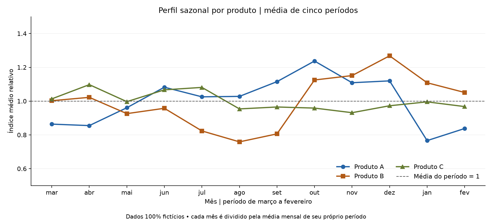
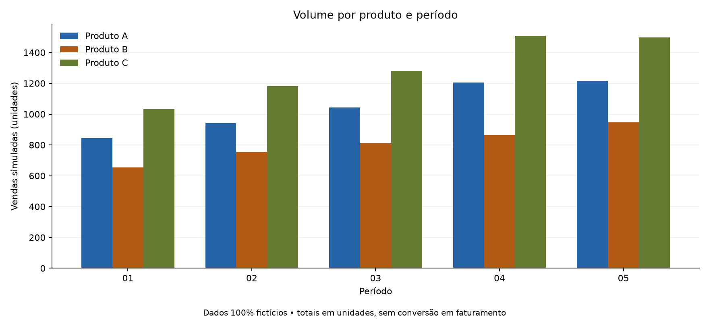

# Análise de Sazonalidade de Vendas

**Padrões mensais por produto para apoiar a investigação da demanda e o planejamento comercial.**

Projeto de portfólio com validação de dados, indicadores por produto e período, visualizações e resultados reproduzíveis.

> Todos os dados, valores e resultados apresentados são **100% fictícios**, gerados por código, sem uso de bases ou parâmetros empresariais privados.

## Perguntas respondidas

- Quais meses têm vendas relativamente maiores ou menores em cada produto?
- Os produtos apresentam o mesmo perfil sazonal?
- Como o volume de cada período se diferencia do padrão relativo dos meses?

<!-- RESULTADOS:SINTETICOS:INICIO -->
## Resultados da demonstração

**180 observações fictícias · 3 produtos · 5 períodos · 12 meses por período.**

### Índices sazonais



Índice `1,00` equivale à média mensal do próprio período; `1,20` equivale a 20% acima dessa referência.

| Mês | Produto A | Produto B | Produto C |
|---|---:|---:|---:|
| mar | 0,86 | 1,00 | 1,01 |
| abr | 0,85 | 1,02 | 1,10 |
| mai | 0,96 | 0,93 | 1,00 |
| jun | 1,08 | 0,96 | 1,07 |
| jul | 1,03 | 0,82 | 1,08 |
| ago | 1,03 | 0,76 | 0,95 |
| set | 1,12 | 0,81 | 0,97 |
| out | 1,24 | 1,13 | 0,96 |
| nov | 1,11 | 1,15 | 0,93 |
| dez | 1,12 | 1,27 | 0,97 |
| jan | 0,77 | 1,11 | 1,00 |
| fev | 0,84 | 1,05 | 0,97 |

### Volume e meses de maior/menor índice



| Produto | Vendas simuladas (unidades) | Maior índice | Menor índice |
|---|---:|---:|---:|
| Produto A | 5.248 | out: 1,24 | jan: 0,77 |
| Produto B | 4.033 | dez: 1,27 | ago: 0,76 |
| Produto C | 6.502 | abr: 1,10 | nov: 0,93 |

### Leitura de negócio

- Na simulação, **Produto A** tem seu maior índice em **out**, 23,7% acima da referência mensal normalizada.
- Na simulação, **Produto B** tem seu maior índice em **dez**, 26,8% acima da referência mensal normalizada.
- Na simulação, **Produto C** tem seu maior índice em **abr**, 9,7% acima da referência mensal normalizada.
- O volume por período mostra a evolução da escala; os índices permitem comparar o perfil dos meses após essa normalização.
- Em uma aplicação comercial, esses recortes apoiariam a investigação de janelas de demanda e o planejamento de capacidade.

Fonte: `scripts/gerar_dados_sinteticos.py`, seed `2026`; reproduza com `python scripts/gerar_portfolio.py`. Resultados inteiramente fictícios: demonstram análise exploratória e não constituem previsão de vendas.
<!-- RESULTADOS:SINTETICOS:FIM -->

## Como funciona

Cada **período vai de março a fevereiro**. As vendas de cada mês são divididas pela média mensal do próprio período; os índices são resumidos entre períodos completos, mantendo a mesma regra de cálculo.

## Metodologias e boas práticas

| Método | O que demonstra | Por que foi utilizado |
| Normalização por período | Perfil mensal relativo à própria média | Permite comparar períodos com escalas diferentes |
| Média, mediana, quartis e mapa mensal | Centro, dispersão e observações do perfil | Permite examinar a representatividade dos resumos |
| Friedman | Comparação exploratória de meses no mesmo período | Respeita o desenho de medidas repetidas |
| Kendall W | Magnitude da concordância dos rankings mensais | Acrescenta tamanho de efeito à leitura do teste |
| BH-FDR | Comparação entre produtos | Ajusta a família completa de testes |

**Controles aplicados:** Grão e janela definidos; zero separado de ausência; cobertura explícita; períodos completos na normalização; efeito acompanhado de histórico; publicação conferida contra a simulação.

Leia o [relatório completo com resultados e interpretações](docs/relatorio.md) e o [guia metodológico com fórmulas e justificativas](docs/metodologia.md).

## Executar no VS Code

No terminal PowerShell, dentro deste repositório:

```powershell
python -m venv .venv
.\.venv\Scripts\Activate.ps1
python -m pip install -r requirements.txt
python scripts/gerar_dados_sinteticos.py
python analise_sazonalidade.py --input data/sazonalidade_sintetica.csv
python scripts/gerar_portfolio.py
python -m pytest -q
```

- `gerar_dados_sinteticos.py`: recria a base fictícia com seed fixa.
- O script analítico gera resultados locais em `outputs/` (CSV analíticos e gráficos).
- `gerar_portfolio.py`: atualiza estas tabelas, o relatório em `docs/relatorio.md` e as imagens em `docs/assets/`, sempre com dados fictícios.
- `pytest`: verifica cálculos, validação e compatibilidade.

## Dados e documentação

| Campo | Significado |
|---|---|
| `Produto` | Produto fictício analisado. |
| `Período` | Janela de março a fevereiro. |
| `Meses` | Mês da observação. |
| `Vendas` | Quantidade vendida, em unidades na demonstração. |

Os cabeçalhos anteriores continuam aceitos para compatibilidade. Os identificadores dos períodos e as fórmulas são preservados.

Consulte o [guia técnico e dicionário de dados](docs/metodologia.md) para regras, testes exploratórios e uso local de dados privados.

**Tecnologias:** Python · pandas · NumPy · SciPy · Matplotlib · pytest.

## Atualizar no GitHub

Depois de salvar as alterações e regenerar os dados e as imagens:

```powershell
git status --short
git add .
python scripts/verificar_publicacao.py
git diff --cached --stat
```

Se a verificação passar, revise os arquivos preparados e publique:

```powershell
git commit -m "Atualiza análise e apresentação dos resultados"
git push
git status --short --branch
```

`add` prepara os arquivos; a verificação confere a base e as imagens sintéticas; `commit` registra a versão local; `push` envia ao GitHub. Se algum comando falhar, interrompa a sequência e confira a mensagem.
