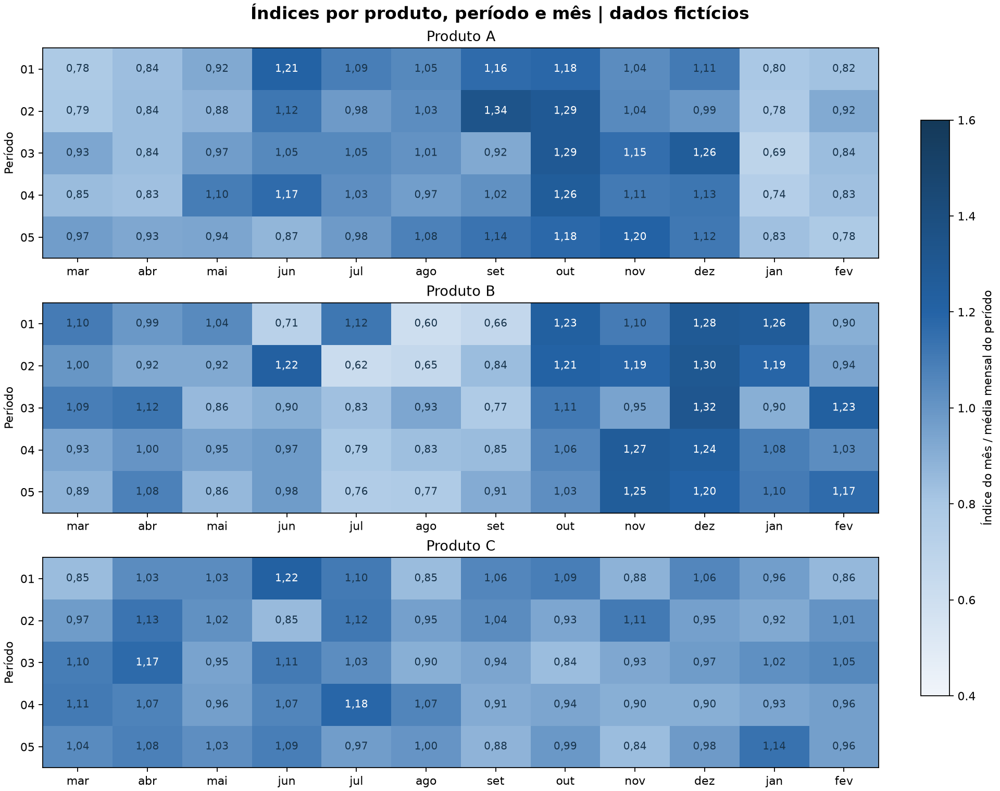

# Relatório de sazonalidade de vendas com dados fictícios

Relatório gerado por código com resumo executivo, análise por produto, métodos e recomendações demonstrativas. Todos os números e nomes de produtos são fictícios, gerados com seed 2026.

## Resumo executivo

A simulação reúne **180 observações mensais**, **3 produtos** e **5 períodos completos por produto**. O total é de **15.783 unidades fictícias**, distribuídas de março a fevereiro. O perfil mensal é comparado após normalizar a escala de cada período.

O relatório apresenta separadamente volume absoluto, padrão relativo, dispersão e testes exploratórios. Essa organização permite discutir planejamento comercial sem confundir crescimento do volume com maior intensidade sazonal.

## Resumo descritivo das vendas mensais

| Produto | Observações | Total (un.) | Média mensal | Mediana | Desvio-padrão | P25 | P75 | Mín. | Máx. |
|---|---|---|---|---|---|---|---|---|---|
| Produto A | 60 | 5.248 | 87,47 | 84,00 | 18,36 | 74,00 | 101,25 | 55 | 126 |
| Produto B | 60 | 4.033 | 67,22 | 67,50 | 14,63 | 58,75 | 76,00 | 33 | 99 |
| Produto C | 60 | 6.502 | 108,37 | 109,50 | 18,35 | 94,00 | 121,00 | 73 | 149 |

**Método e motivo:** média e mediana resumem posições centrais; desvio-padrão e quartis descrevem dispersão. A média não é o volume total e a mediana, sozinha, não mede estabilidade. Cada linha reúne 60 meses, com cinco observações de cada mês do calendário comercial.

## Volume por período

| Produto | Período | Vendas (un.) |
|---|---|---|
| Produto A | Ciclo 01 | 845 |
| Produto A | Ciclo 02 | 942 |
| Produto A | Ciclo 03 | 1.042 |
| Produto A | Ciclo 04 | 1.204 |
| Produto A | Ciclo 05 | 1.215 |
| Produto B | Ciclo 01 | 655 |
| Produto B | Ciclo 02 | 756 |
| Produto B | Ciclo 03 | 812 |
| Produto B | Ciclo 04 | 863 |
| Produto B | Ciclo 05 | 947 |
| Produto C | Ciclo 01 | 1.033 |
| Produto C | Ciclo 02 | 1.182 |
| Produto C | Ciclo 03 | 1.281 |
| Produto C | Ciclo 04 | 1.509 |
| Produto C | Ciclo 05 | 1.497 |


**Método e motivo:** somar o volume mostra a escala comercial. A comparação do perfil dos meses usa índices relativos para evitar que um período maior domine a referência. Cada período elegível tem peso igual.

## Perfil mensal normalizado


A normalização usa `índice = vendas do mês / média mensal do próprio período`. Depois calcula média e mediana desses índices entre os períodos completos. A média é feita sobre índices normalizados, sem dividir totais de bases diferentes. Um índice de 1,20 significa 20% acima da média mensal daquele período.

| Produto | Mês | Índice médio | Índice mediano | Faixa descritiva | Períodos utilizados |
|---|---|---|---|---|---|
| Produto A | mar | 0,864 | 0,847 | Abaixo: moderado | 5 |
| Produto A | abr | 0,855 | 0,841 | Abaixo: moderado | 5 |
| Produto A | mai | 0,961 | 0,938 | Próximo da média | 5 |
| Produto A | jun | 1,082 | 1,121 | Acima: moderado | 5 |
| Produto A | jul | 1,025 | 1,027 | Próximo da média | 5 |
| Produto A | ago | 1,028 | 1,032 | Próximo da média | 5 |
| Produto A | set | 1,115 | 1,136 | Acima: moderado | 5 |
| Produto A | out | 1,237 | 1,256 | Acima: forte | 5 |
| Produto A | nov | 1,109 | 1,106 | Acima: moderado | 5 |
| Produto A | dez | 1,120 | 1,116 | Acima: moderado | 5 |
| Produto A | jan | 0,766 | 0,777 | Abaixo: forte | 5 |
| Produto A | fev | 0,838 | 0,827 | Abaixo: moderado | 5 |
| Produto B | mar | 1,002 | 1,000 | Próximo da média | 5 |
| Produto B | abr | 1,022 | 1,001 | Próximo da média | 5 |
| Produto B | mai | 0,926 | 0,921 | Abaixo: moderado | 5 |
| Produto B | jun | 0,957 | 0,973 | Próximo da média | 5 |
| Produto B | jul | 0,823 | 0,793 | Abaixo: moderado | 5 |
| Produto B | ago | 0,759 | 0,773 | Abaixo: forte | 5 |
| Produto B | set | 0,806 | 0,841 | Abaixo: moderado | 5 |
| Produto B | out | 1,125 | 1,108 | Acima: moderado | 5 |
| Produto B | nov | 1,151 | 1,190 | Acima: moderado | 5 |
| Produto B | dez | 1,268 | 1,282 | Acima: forte | 5 |
| Produto B | jan | 1,109 | 1,102 | Acima: moderado | 5 |
| Produto B | fev | 1,051 | 1,029 | Acima: moderado | 5 |
| Produto C | mar | 1,013 | 1,042 | Próximo da média | 5 |
| Produto C | abr | 1,097 | 1,082 | Acima: moderado | 5 |
| Produto C | mai | 0,997 | 1,015 | Próximo da média | 5 |
| Produto C | jun | 1,067 | 1,090 | Acima: moderado | 5 |
| Produto C | jul | 1,081 | 1,104 | Acima: moderado | 5 |
| Produto C | ago | 0,954 | 0,954 | Próximo da média | 5 |
| Produto C | set | 0,965 | 0,937 | Próximo da média | 5 |
| Produto C | out | 0,959 | 0,938 | Próximo da média | 5 |
| Produto C | nov | 0,931 | 0,899 | Abaixo: moderado | 5 |
| Produto C | dez | 0,972 | 0,974 | Próximo da média | 5 |
| Produto C | jan | 0,996 | 0,964 | Próximo da média | 5 |
| Produto C | fev | 0,968 | 0,962 | Próximo da média | 5 |

**Método e motivo:** apresentar média e mediana permite examinar a sensibilidade aos valores mais altos. As faixas indicam desvios descritivos da referência 1,00, sem equivaler a significância estatística.

## Comparação mês a mês entre períodos



**Método e motivo:** o mapa mantém visíveis os cinco índices de cada mês, permitindo conferir se o resumo médio representa padrões recorrentes ou observações concentradas em um período. Todos os painéis usam a mesma escala de cor; os valores são mostrados nas células.

## Testes exploratórios e tamanho de efeito

| Produto | Períodos completos | Friedman χ² | p aproximado | q BH | Kendall W |
|---|---|---|---|---|---|
| Produto A | 5 | 41,880 | 0,000017 | 0,000051 | 0,761 |
| Produto B | 5 | 36,518 | 0,000139 | 0,000208 | 0,664 |
| Produto C | 5 | 16,512 | 0,123175 | 0,123175 | 0,300 |

**Friedman:** compara os 12 meses como medidas repetidas nos mesmos períodos. O período é o bloco; a associação entre observações do mesmo período é respeitada na estrutura da comparação. O código requer ao menos três períodos completos e soma positiva.

**Kendall W:** `χ² / [n × (12 − 1)]` descreve a magnitude da concordância dos rankings mensais. A medida acompanha o p-valor para dar contexto à intensidade do padrão observado.

**Benjamini–Hochberg:** ajusta a família completa de três testes, um por produto. O q apresentado é o p ajustado pelo procedimento BH. A escolha atende ao objetivo exploratório de controlar a taxa de descobertas falsas nas condições do método.

**Critério de leitura:** p e q usam aproximação qui-quadrado. Com cinco períodos, são demonstrações exploratórias; a documentação do SciPy recomenda mais de dez observações por medida e mais de seis medidas repetidas para confiar nessa aproximação. A interpretação combina índices, dispersão e W. Um teste global não identifica quais pares de meses diferem, e q acima de 5% não prova ausência de sazonalidade.

## Leitura executiva por produto

| Produto | Maior índice médio | Menor índice médio | Aplicação comercial possível |
|---|---|---|---|
| Produto A | out: 1,24 (23,7% acima da referência) | jan: 0,77 | Investigar demanda em out e antecipar planejamento de capacidade |
| Produto B | dez: 1,27 (26,8% acima da referência) | ago: 0,76 | Investigar demanda em dez e antecipar planejamento de capacidade |
| Produto C | abr: 1,10 (9,7% acima da referência) | nov: 0,93 | Investigar demanda em abr e antecipar planejamento de capacidade |

O quadro traduz a simulação em perguntas para planejamento. Antecedência de campanhas, estoque ou capacidade deve considerar prazo de venda, margem, orçamento e entrega, informações que precisam ser levantadas antes de transformar um padrão descritivo em decisão operacional.

## Cobertura e qualidade

| Produto | Período | Meses observados | Completo |
|---|---|---|---|
| Produto A | Ciclo 01 | 12 | Sim |
| Produto A | Ciclo 02 | 12 | Sim |
| Produto A | Ciclo 03 | 12 | Sim |
| Produto A | Ciclo 04 | 12 | Sim |
| Produto A | Ciclo 05 | 12 | Sim |
| Produto B | Ciclo 01 | 12 | Sim |
| Produto B | Ciclo 02 | 12 | Sim |
| Produto B | Ciclo 03 | 12 | Sim |
| Produto B | Ciclo 04 | 12 | Sim |
| Produto B | Ciclo 05 | 12 | Sim |
| Produto C | Ciclo 01 | 12 | Sim |
| Produto C | Ciclo 02 | 12 | Sim |
| Produto C | Ciclo 03 | 12 | Sim |
| Produto C | Ciclo 04 | 12 | Sim |
| Produto C | Ciclo 05 | 12 | Sim |

A simulação tem 15 combinações produto × período, todas com os 12 meses. Na entrada de uso geral, vendas devem ser numéricas, finitas e não negativas; produto, período e mês devem estar preenchidos. Meses desconhecidos e cabeçalhos ambíguos são rejeitados. Registros repetidos no grão mensal são somados pela regra de agregação, sem afirmar que toda repetição é uma duplicata indevida.

Períodos incompletos permanecem nos totais e na cobertura; ficam fora dos índices e do teste. Um zero observado é um valor válido; ausência de mês permanece ausência. Períodos com soma zero também ficam fora da normalização.

## Recomendações demonstrativas

| Aplicação | Evidência a examinar | Próxima validação |
|---|---|---|
| Planejamento de demanda | Índices médios e medianos por mês | Conferir repetição no mapa e ampliar histórico |
| Capacidade de operação | Volume absoluto e dispersão mensal | Levantar prazo de entrega, capacidade e nível de serviço |
| Planejamento comercial | Meses relativamente mais intensos por produto | Relacionar campanhas e prazos sem atribuir causalidade ao calendário |
| Monitoramento | Novos períodos completos e cobertura | Atualizar índices e conferir mudanças de mix e cadastro |

Essas ações exemplificam uso de dados; não representam implantação, previsão ou ganho financeiro realizado.

## Reprodutibilidade

```powershell
python scripts/gerar_dados_sinteticos.py
python analise_sazonalidade.py
python scripts/gerar_portfolio.py
python -m pytest -q
```

Este relatório e o mapa são regenerados com dados fictícios pelo mesmo comando do portfólio. A base, as imagens e o relatório são conferidos no índice Git antes do commit.

[Metodologia e justificativas](metodologia.md) · [Voltar ao README](../README.md)
